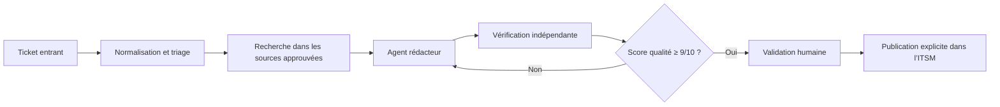

<h1 align="center"></h1>

<p align="center"><strong>Un studio open source pour concevoir, exécuter et contrôler des workflows d’automatisation du support.</strong><br>
Des demandes entrantes aux réponses documentées, avec une validation humaine avant toute publication externe.</p>

<p align="center">
  <a href="https://github.com/Younsko/support-workflow-studio/actions/workflows/ci.yml"></a>
  &nbsp; · &nbsp; <a href="#démonstration">Démonstration</a>
  &nbsp; · &nbsp; <a href="#démarrage-rapide">Démarrage rapide</a>
  &nbsp; · &nbsp; <a href="docs/architecture.md">Architecture</a>
  &nbsp; · &nbsp; <a href="LICENSE">Licence MIT</a>
</p>

## Démonstration

Ce film de 14 secondes présente le parcours d’une demande de support : réception, qualification, recherche documentaire approuvée, travail de plusieurs agents, contrôle qualité, boucle de révision et décision humaine.

https://github.com/user-attachments/assets/ed8991ed-b710-4aa4-974f-c2804bec74ab

La vidéo et les libellés à l’écran sont en français. [Télécharger le MP4](motion_demo/support-workflow-demo.mp4) · [Crédits du film](motion_demo/README.md)

## La vision

Support Workflow Studio vise à rendre les automatisations de support aussi lisibles et gouvernables que des workflows construits dans un studio visuel : chaque étape a une responsabilité claire, ses entrées sont explicites, et les décisions importantes restent vérifiables.

À terme, une équipe pourra connecter son ITSM, ses sources de connaissances, ses modèles hébergés ou locaux, puis composer ses propres automatisations depuis un canvas. Un même socle pourra accueillir les demandes simples de niveau 1, les investigations spécialisées, les escalades d’ingénierie et des workflows d’exploitation plus avancés.

Le projet avance vers une plateforme d’équipe avec identité et rôles, exécutions durables, runner contrôlé par le client, catalogue de connecteurs, intégrations de messagerie comme Teams ou Slack, gouvernance et déploiement à l’échelle. Ces capacités restent une direction produit : consultez [l’état SaaS et les étapes de livraison](docs/saas-readiness.md) pour distinguer ce qui existe déjà de ce qui reste à construire.

## Le workflow support



Le runtime prépare un brouillon à partir du ticket et des éléments de connaissance disponibles. Des contrôles déterministes, un vérificateur et des voies de revue spécialisées évaluent la réponse. Une personne peut l’approuver, la modifier ou la rejeter. La publication vers Jira Service Management est une action distincte, précédée d’une nouvelle vérification de l’état du ticket.

Le canvas permet d’enregistrer et de publier des versions immuables. Aujourd’hui, seul le flux linéaire de démarrage est exécutable, sur un ticket relié à Jira Service Management et lorsque les connexions Jira, documentation et modèle correspondent à la configuration locale. Les graphes non pris en charge sont refusés avant tout appel externe.

## Ce que contient le prototype

- **Canvas visuel** : étapes configurables, palette, inspecteur, validation, historique des versions et création d’un brouillon depuis une version publiée.
- **Exécution bornée** : compilation stricte du flux de démarrage, vérification des empreintes et des connexions, rattachement à la version publiée et clé d’idempotence locale pour éviter de relancer un run déjà terminé après un retry. La chronologie affiche aussi les durées enregistrées par étape pour les runs publiés.
- **Orchestration de support** : qualification N1 à N3+, pistes d’investigation spécialisées, planification avec boucle architecte/critique/révision et seuil de qualité, vérification indépendante et éléments de preuve.
- **Sources de connaissance** : dossier local dont les fichiers sont explicitement autorisés ou recherche Confluence en lecture seule avec consentement et périmètre définis.
- **Modèles** : mode déterministe de démonstration, Ollama local, API compatibles OpenAI et Anthropic selon la configuration locale.
- **Contrôle humain** : approbation ou rejet du brouillon, relecture après édition et publication Jira séparée. Le système bloque les réponses sous le seuil qualité et les résultats d’envoi incertains ne sont pas réessayés automatiquement.
- **Interface bilingue** : application, configuration et canvas en français et en anglais.

## Démarrage rapide

Le mode démo utilise des tickets et une base de connaissances synthétiques. Python 3.11+ et Node.js 20+ sont nécessaires.

```sh
git clone https://github.com/Younsko/support-workflow-studio.git
cd support-workflow-studio
python -m venv .venv
.venv/bin/python -m pip install -e .
npm --prefix frontend ci
npm --prefix frontend run build
.venv/bin/python -m uvicorn app.main:app --app-dir backend
```

Sous Windows, remplacez `.venv/bin/python` par `.venv\Scripts\python.exe`.
Ouvrez ensuite [http://127.0.0.1:8000](http://127.0.0.1:8000), sélectionnez le ticket synthétique proposé et lancez le workflow. Le mode démo n’exige ni clé de modèle ni compte Jira.

Pour connecter Jira Service Management ou une source de connaissances, commencez par le [guide de configuration](docs/connector-setup.md). Les clés restent sur la machine locale dans le fichier `.env` ignoré par Git. La connexion à un modèle externe exige une activation explicite de l’envoi de données.

## Une interface de workflow, pensée pour être modifiée

Le studio reprend les repères familiers des outils de workflow : canvas central, étapes reliées, bibliothèque de nœuds, inspecteur de configuration et accès à l’historique. L’interface est développée en React, TypeScript et CSS. La direction visuelle s’appuie sur les recommandations du plugin **Impeccable** ; l’implémentation reste dans le code du projet et n’ajoute pas de dépendance de design à l’application.

## Architecture et limites actuelles

Le projet sépare les définitions de workflow, le runtime de support, les adaptateurs ITSM et les fournisseurs de modèles. Les données de démonstration sont synthétiques. L’application actuelle est un prototype local mono-opérateur : les versions et l’état d’exécution utilisent SQLite, et aucune identité d’équipe ni isolation multi-tenant n’est encore fournie.

Ce dépôt ne prétend pas encore être prêt pour une exploitation SaaS à grande échelle. Les prochaines étapes portent sur l’authentification et les espaces de travail, un runner durable, la reprise idempotente après incident, les rôles d’approbation, davantage de connecteurs, la sécurité de bout en bout, l’observabilité, les sauvegardes et les tests de charge. Les limites détaillées sont documentées dans [l’état de préparation SaaS](docs/saas-readiness.md) et le [modèle de menace](docs/threat-model.md).

## Développement

Les tests backend utilisent des données synthétiques :

```sh
python -m pytest backend/tests -q
python -m ruff check backend/app backend/tests
npm --prefix frontend run build
```

Pour développer l’interface, démarrez FastAPI puis `npm --prefix frontend run dev` dans un second terminal. Vite relaie les appels `/api` vers le backend local. Voir le [guide des connecteurs](docs/connector-development.md), les [tests backend](backend/tests) et le [workflow CI](.github/workflows/ci.yml).

## Licence

Le code de l’application est distribué sous licence [MIT](LICENSE). La musique de la vidéo est créditée dans le [dossier du film](motion_demo/README.md).
