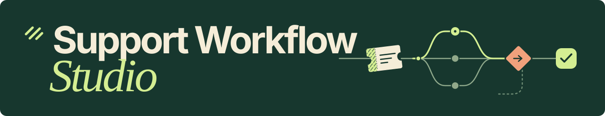
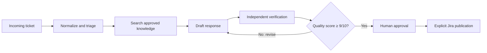

<h1 align="center"></h1>

<p align="center"><strong>An open-source studio for designing, running, and governing support automation workflows.</strong><br>
From incoming requests to evidence-based drafts, with a human decision before any external publication.</p>

<p align="center">
  <a href="https://github.com/Younsko/support-workflow-studio/actions/workflows/ci.yml"></a>
  &nbsp; · &nbsp; <a href="#demo">Demo</a>
  &nbsp; · &nbsp; <a href="#quick-start">Quick start</a>
  &nbsp; · &nbsp; <a href="docs/architecture.md">Architecture</a>
  &nbsp; · &nbsp; <a href="LICENSE">MIT license</a>
</p>

## Demo

This 14-second motion design follows a synthetic support request from intake through triage, approved guidance, agent review, a quality gate, human approval, and a separate Jira publication step. It is an animated product vision, not a screen recording of the current app.

https://github.com/user-attachments/assets/18cb1554-ef74-4db2-bff0-190f19234f6e

[Watch or download the full English demo](motion_demo/support-workflow-demo.mp4) · [Editable OpenMotion source project](motion_demo/Signal-Path-OpenMotion-English.zip)

## Vision

Support Workflow Studio makes support automation understandable and governable. Each step has a clear responsibility, its inputs are visible, and consequential decisions can be reviewed.

Teams should be able to connect an ITSM, approved knowledge sources, and hosted or local models, then shape automations in a visual canvas. The same foundation is intended to support routine level-one requests, specialist investigations, engineering escalations, and more advanced operations workflows.

The product is moving toward team workspaces, durable runs, a customer-controlled runner, a broader connector catalog, chat entry points such as Teams or Slack, and stronger governance. These are roadmap goals; see the [SaaS readiness plan](docs/saas-readiness.md) for what exists today and what remains.

## The support workflow



The runtime prepares a draft from a ticket and available knowledge. Deterministic checks, an independent verifier, and specialist review lanes assess the response. A person can approve, edit, or reject it. Publishing to Jira Service Management is a separate action and rechecks the ticket state before writing.

The canvas can save and publish immutable workflow versions. Today, only the constrained linear starter flow is executable, and only when the Jira, knowledge, and model connections match the local configuration. Unsupported graphs are rejected before external work begins.

## What the prototype includes

- **Visual canvas:** configurable steps, node palette, inspector, validation, version history, and draft creation from a published version.
- **Bounded execution:** strict compilation of the starter flow, configuration and fingerprint checks, immutable version binding, local idempotency keys, and persisted stage timing for published runs.
- **Support orchestration:** level-one through level-three-plus triage, specialist investigation lanes, an architect/critic/revision loop with a quality threshold, independent verification, and evidence references.
- **Knowledge sources:** an operator-approved local folder or read-only, scope-limited Confluence search with explicit consent.
- **Model providers:** deterministic demo mode, local Ollama, Ollama Cloud through its compatible API, and compatible OpenAI or Anthropic APIs, configured locally with destination-scoped credentials and explicit external-inference consent.
- **Human control:** approve, edit, or reject a draft; re-review edits; and publish to Jira in a separate step. Low-quality drafts are blocked, and uncertain write outcomes are not retried automatically.
- **Bilingual application UI:** English and French translations for the application, setup, and workflow canvas.

## Quick start

The demo uses synthetic tickets and a synthetic knowledge base. Python 3.11+ and Node.js 20+ are required.

```sh
git clone https://github.com/Younsko/support-workflow-studio.git
cd support-workflow-studio
python -m venv .venv
.venv/bin/python -m pip install -e .
npm --prefix frontend ci
npm --prefix frontend run build
.venv/bin/python -m uvicorn app.main:app --app-dir backend
```

On Windows, replace `.venv/bin/python` with `.venv\Scripts\python.exe`.
Open [http://127.0.0.1:8000](http://127.0.0.1:8000), select the synthetic sample ticket, and start the workflow. Demo mode needs no model API key or Jira account.

For a local container preview, see the [self-hosted Compose guide](docs/self-hosted-container.md). It binds to loopback and keeps workflow state in a named local volume.

To connect Jira Service Management or a knowledge source, start with the [connector setup guide](docs/connector-setup.md). Keys stay on the local machine in the Git-ignored `.env` file. External model use requires explicit consent to send the data required by the selected provider.

## Design and motion

The application is built with React, TypeScript, and CSS. The visual direction was guided by the **Impeccable** design plugin, with the implementation kept in the project’s own components and styles. The workflow film was composed in code with **OpenMotion** and its Decision Tree template. Its editable source project is included; the user-supplied music track is not part of the source archive.

## Architecture and current limits

Workflow definitions, the support runtime, ITSM adapters, model providers, and the metadata-only control plane are separate parts of the system. Demo records are synthetic. The support application remains a local, single-operator prototype by default, with workflow and run state in SQLite. Its experimental opt-in OIDC flow exchanges the organization sign-in for a short-lived workspace/runner token, enforces a route role matrix, and records an HMAC-pseudonymous actor ID and role on approval/publication audit events. The support UI targets the single workspace/runner configured for its installation; there is no workspace switcher, tenant-scoped execution storage, or last-moment authorization check before Jira publication. The standalone control-plane console and API manage workspace membership and runner metadata in a separate database. Optional startup identity binding pins runtime databases to one workspace/runner pair. See the [control-plane foundation notes](docs/control-plane-foundation.md) for setup and the opt-in limits.

This project does not yet claim production SaaS or large-scale readiness. SQLite is the default store, with an opt-in Postgres runtime store for one runner host. The Compose package is a local installation preview, not a hosted team service. Remaining work includes workspace switching, tenant-scoped execution, fresh authorization before external writes, durable step recovery, more connectors, private data paths, observability, backups, and load testing. See the [SaaS readiness plan](docs/saas-readiness.md) and [threat model](docs/threat-model.md) for details.

## Development

Backend tests use synthetic data:

```sh
python -m pytest backend/tests -q
python -m ruff check backend/app backend/tests
npm --prefix frontend run build
```

For UI development, start FastAPI and run `npm --prefix frontend run dev` in a second terminal. Vite proxies `/api` to the local backend. See the [connector development guide](docs/connector-development.md), [backend tests](backend/tests), and [CI workflow](.github/workflows/ci.yml).

### Workspace console preview

To preview the separate workspace console, start the control-plane API in one terminal:

```sh
cd backend
python -m uvicorn app.control_plane.api:app --host 127.0.0.1 --port 8001
```

Then start its Vite page in another terminal from the repository root:

```sh
npm --prefix frontend run dev:control-plane
```

Open `http://127.0.0.1:5174/control-plane.html`. With no identity-provider configuration, the page shows the setup state; signing in and managing a workspace requires Postgres and the OIDC settings described in the [control-plane notes](docs/control-plane-foundation.md). This preview does not authenticate or authorize the ticket application.

## License

The application code is distributed under the [MIT license](LICENSE). Music credits for the demo are documented in the [motion film notes](motion_demo/README.md).
