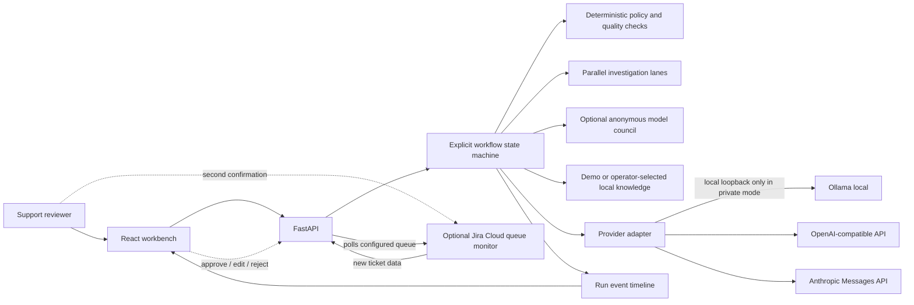

# Architecture

## Runtime shape

The prototype keeps orchestration in application code. Models propose classifications, independent lane findings, plans, drafts, and reviewer findings; deterministic code owns allowed transitions, retry limits, score calculation, case selection, and the final approval boundary. Investigation lanes inspect separate aspects of the report before planning; specialist reviewer lanes score the completed draft later. Their outputs are shown separately. No model can call an external support system. The optional JSM adapter monitors a human-configured queue in a server-side polling loop; optional auto-triage creates review-only runs and cannot publish replies or commits. The adapter can post a public reply only after a separate explicit action following draft approval and a check that the ticket text still matches the snapshot reviewed by that run. Jira triage requires an operator-selected local knowledge folder and blocks publication when no source matches.

The runtime depends on a `WorkflowStateStore` protocol rather than storage-specific methods. `LocalStore` is its only implementation today; it keeps the app's current SQLite behavior while defining a seam for a future Postgres runner store. The workflow definition registry remains separate and local, so this protocol does not yet make the application horizontally scalable or switchable to Postgres.

The visual workflow registry stores immutable, hashed versions separately from the ticket runtime. `POST /api/v1/workflows/{id}/runs` loads the requested version, verifies its stored content hash, and compiles only the exact linear starter graph against the current Jira, knowledge, and model configuration. The compiler rejects branches, unsupported ordering, extra tools, unresolved or mismatched references, and changed configuration before reading the external ticket. A successful compile passes the bounded agent role and instructions to the existing workflow runtime and records the workflow ID, version, hash, and node IDs on the resulting run. This is a constrained bridge to the existing runtime, not a general node-by-node graph engine: unsupported graphs do not run, and Jira approval and publication remain separate operations.

Published runs also require a persisted idempotency key. A local SQLite transaction reserves the key and a one-hour lease, binding it to the case, immutable workflow version, and run options. A duplicate while the lease is active returns a conflict; a completed retry returns the saved result; a failed or expired claim can be acquired again under a new lease owner. The result and claim completion are committed together, so the same request cannot complete twice. Each completed workflow stage renews the owner-fenced lease and writes a content-free stage checkpoint (attempt, stage ID, status, duration, timestamp); operators can inspect them through `GET /api/workflows/{run_id}/execution-steps`. Run lifecycle audit events now create a metadata-only outbox row in the same SQLite transaction. A local dispatcher can lease bounded batches, acknowledge them with a fresh per-claim token, or release them with a bounded error code and retry time; expired leases can be reclaimed without accepting a stale token from the prior attempt. No dispatcher, external event delivery, Postgres implementation, tenant isolation, or multi-worker guarantee exists yet. Interrupted workflow attempts still rerun from the beginning, so step-level resume remains a production gate.

`PRIVATE_LOCAL_MODE=true` is a local-only guard. Startup requires `ollama-local` on loopback and refuses any Jira connector settings, Jira auto-triage, external inference consent, or model council/judge profile. The API blocks Jira queue sync and public reply writes; the provider disables inherited proxies and rejects Ollama model-list entries smaller than 16 MiB. This size check is a heuristic against current cloud model stubs, not proof that a local daemon cannot relay data. Private cases must be minimized and entered manually. Verify local inference and network behavior before connecting confidential data.

When `backend/app/static/index.html` exists, FastAPI serves the UI and API from the same local origin. Vite writes production assets into that package directory so they can be included in a Python wheel. In development, Vite proxies `/api` to the loopback FastAPI server.

## Data boundaries

- **Reported:** the original synthetic ticket text, preserved as user input.
- **Inferred:** category, urgency, provisional support tier (N1, N2, N3, N3+), and confidence; visibly labeled for human verification. Deterministic fallback rules promote reported broad impact, security, or recurrence for review; they do not confirm an incident or assign an organization-specific SLA.
- **Verified:** statements supported by a named local knowledge item, with source IDs shown beside the draft.
- **Unknown:** missing, contradictory, or unverified details; the workflow must surface these rather than fill them in.

Every workflow run has a run ID, current stage, stage outcomes, score rubric, revision count, and human decision state. Cases, workflow runs, Jira seen-ticket state, monitor baselines, local tags, and pending auto-triage attempts are persisted in the local SQLite database and restored when the server starts. This supports one local process on one host; it is not a tenant-scoped or distributed production store. Auto-triage requires a Jira creation time later than both the first successful monitor poll and the latest opt-in activation; older backlog items are not automatically processed when enabling it. A production implementation still needs tenant-scoped storage, retention rules, access control, encryption, backups, and tamper-evident audit records.

Jira-linked workflow runs keep a SHA-256 fingerprint of the exact summary and description used during triage. Before publishing, the connector fetches the request again and compares that content with the immutable run fingerprint. A queue refresh cannot replace the reviewed snapshot; changed ticket text requires a new triage run and a new human approval.

The dashboard's metrics are calculated from cases and workflow runs loaded from the local SQLite store. Median triage time measures workflow generation duration, not customer first-response time. Reviewer approval/edit/rejection figures count workflow runs, not unique tickets. They are local prototype metrics, not a production analytics ledger.

The product-signal panel groups cases only when their latest non-failed workflow assigned the same inferred category and at least two cases share it. It links to the source requests, exposes each model confidence for review, and can copy a deterministic escalation brief with explicit unknowns. The brief contains ticket keys and titles, so the operator must review it before sharing. It does not claim a shared root cause, create engineering tickets, or make external writes.

## Workflow states

`received → classified → evidence_gathered → investigation_lanes → [optional blind council] → planned ↔ plan_review → candidates_built → verified → specialist_reviewed ↔ bounded_draft_revision → quality_gate → awaiting_human → approved | rejected`

Approved and rejected states are terminal. A low-scoring draft can receive one model revision when the configured call budget allows; the verifier and specialist reviewers then run again. Human edits also receive a fresh review, increment the approval version, and require a new explicit approval. At most three total draft revisions are allowed per run. Decisions include the version the reviewer saw, so a queued decision for an older draft is rejected. A score below 9/10 cannot be approved. Draft approval does not publish a comment; the operator must activate a second JSM action. The GitHub branch commit workflow remains an extension point and is not yet implemented.

## Failure handling

- Provider timeout or malformed output becomes a visible failed stage and leaves the ticket awaiting human review.
- Each run has a configured model-call budget and request timeout.
- Investigation lanes and final specialist review lanes are separate, independent, and read-only. Their findings are merged by code; model-generated investigation results remain unverified leads until checked against cited evidence.
- Candidate selection uses first-passing deterministic acceptance checks for evidence reference, uncertainty, and secret handling. It is not a full candidate ranking; if none passes, the first candidate is retained and hard checks may stop approval.
- Opt-in Jira auto-triage retries caught workflow-generation failures on later polls, with at most three attempts per ticket. Seen IDs, baselines and pending attempts checkpoint to local SQLite; pending IDs outside a truncated queue scan are retained but are not processed until a later scan confirms they are still in the configured queue. Each retry refreshes the request and skips tickets Jira marks complete. Paused items remain review-only and visible; they never trigger a public reply or code commit.
- No automatic retries across external side effects exist. The optional JSM public-comment action is the only external write implemented in this prototype.
- JSM comment outcomes that cannot be confirmed are marked as unknown; the operator must inspect the ticket before retrying. Run records and monitor checkpoints persist across restarts, but the in-process guard is not a distributed lease and there is no multi-worker coordination. The API can poll and build review-only runs unattended on one local process, but this is not suitable for unattended public replies or shared production deployment.

## Production extension points

Deployment target, identity provider, ticketing platform, tenant model, retention, legal basis, and SLOs are intentionally unspecified. They must be decided before adding connectors or real customer data. See [production-readiness.md](production-readiness.md).
