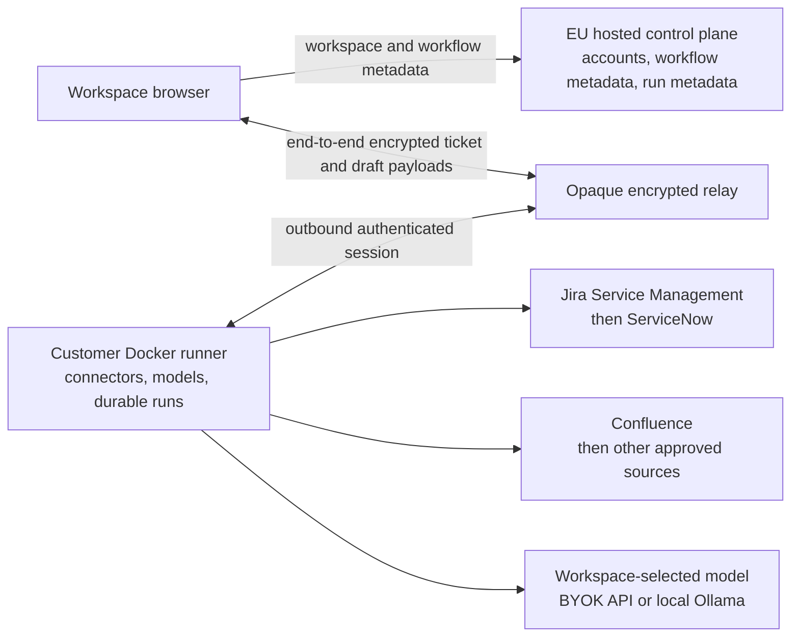

# SaaS readiness and delivery gates

This document distinguishes the current local prototype from the hosted product direction. It is not a claim that hosted SaaS, tenant isolation, or encrypted browser-to-runner transport is already implemented.

See [the security threat model](threat-model.md) for the current trust boundaries, verified prototype controls, and production security gates.

## Current product boundary

The repository currently provides a single-operator FastAPI and React prototype. It has a code-defined ticket runtime plus a separate visual workflow editor, a local versioned-definition API, synthetic demo cases, a Jira Service Management Cloud adapter, local knowledge-folder retrieval, and provider adapters for demo, OpenAI-compatible APIs, Anthropic, and local Ollama. A draft must pass deterministic review gates and receive a human decision; publishing a Jira reply is a separate action. JSM has not been validated against a real customer sandbox as part of this release.

The current support app is not a multi-user SaaS. The visual editor can save, validate, publish, and fork local workflow definitions. A fail-closed compiler connects the exact linear starter sequence to the existing ticket runtime when Jira, knowledge, and model bindings match; unsupported graphs are rejected. Runs require a Jira-linked case, record the immutable workflow version/hash and node IDs, use the configured agent role and bounded drafting guidance, and preserve separate human approval and publication. Definitions remain in local SQLite. The Setup panel configures one local Jira Service Management connection, either an approved local knowledge folder or a read-only, scope-limited Confluence Cloud source, triage rules, demo/API/Ollama model settings, and an optional runner heartbeat credential. A standalone, metadata-only OIDC service has workspace, membership, invitation, role, runner, heartbeat, and audit APIs in its own Postgres store. An experimental OIDC bridge authenticates the support UI and protects runner routes with workspace roles, with a fresh control-plane authorization check before Jira publication. The runner and workspace are fixed per installation; execution rows are not tenant-scoped. ServiceNow, end-to-end encrypted review, hosted billing, and production SLOs are not implemented. Runtime data defaults to SQLite; setting `SUPPORT_WORKFLOW_DATABASE_URL` opts the customer runner into a Postgres implementation for cases, runs, idempotency leases, stage journals, audit/outbox events, and monitor checkpoints. Workflow definitions still use SQLite, all rows are unscoped to tenants, and the API retains in-memory caches/locks. Postgres storage primitives do not yet make multiple API workers safe. Interrupted runs restart from their beginning. Do not use this release to claim production readiness or large-scale capacity.

### Implemented in this branch

- Typed version-1 workflow graph definitions, deterministic graph/configuration validation, per-node configuration allowlists, read-only agent-tool allowlists, secret-key rejection, and a required approval gate on every path to a publish node.
- A shared English/French locale switch for the application shell, inbox, Setup panel, and visual workflow editor. The locale preference is stored in the browser; ticket text and model-generated content remain in their source language unless a workflow explicitly translates them.
- A single-host Docker Compose installation preview with a loopback-only port, non-root process, read-only container root, and named local state/configuration volume. It packages the current single-operator prototype; it is not the enrolled customer runner or an authenticated deployment.
- A six-step local setup guide for ticket source, approved knowledge, model, triage rules, optional runner connection, and final review. It shows local/demo defaults, automatic-intake behavior, saved-but-untested model state, metadata-only heartbeat status, and a secret-free summary before saving.
- A bilingual visual workflow editor with a starter support flow, node palette and inspector, local validation, save, immutable version publish/fork controls, and a run action for the currently supported starter graph.
- A published-version history in the canvas showing immutable version numbers, publication timestamps, and content hashes, with an explicit latest-version fork action and stale-draft handling.
- Keyboard-accessible move-earlier/move-later controls for the current linear sequence; the ticket trigger stays first, and any order/topology outside the supported starter graph fails closed at run time.
- A local, read-only Confluence Cloud knowledge source with an operator-selected space allowlist, explicit site/space-bound consent for minimized ticket search terms, user-triggered connection check, bounded reads, current-page revalidation, and source-version metadata in evidence. No real tenant has been validated in this release.
- Canvas Connections controls open the local Setup panel and reflect Jira, approved knowledge, and model-configuration state in the draft's declarative references. Primary model keys and external-data consent are bound to the chosen provider and endpoint; optional council and judge profiles require separate scoped keys and consent. The UI reports remote model settings as saved but untested.
- Loopback-only `/api/v1/workflows` endpoints backed by local SQLite, revision checks against stale drafts, HTTP 409 conflicts when a fork already exists, immutable published snapshots, integrity-checked content hashes, metadata-only local audit events, and `POST /api/v1/workflows/{id}/runs` for the supported starter graph.
- A separate metadata-only control-plane API with RS256 OIDC bearer validation, workspace membership and roles, one-time email-bound invitations, Owner/Admin policy checks, last-Owner protection, and actor-attributed metadata audit events. It uses its own Postgres tables and service image; the support UI can now exchange organization sign-in for a short-lived runner session.
- Metadata-only runner registration: Owners/Admins can issue a one-time hashed runner token expiring within 90 days, workspace members can inspect runner timestamps, and revoked or expired credentials stop heartbeat updates. Enroll/revoke operations create audit events, and the runner uses the control plane to recheck active membership before a Jira reply. Once the API URL, enrolled runner ID, and one-time credential are configured in local Setup, the runner sends timestamp-only heartbeats at a configurable interval. HTTPS ingress, request throttling, token-header redaction, automated credential renewal, and deployment-level integration tests remain required before public exposure.
- A short-lived RS256 workspace/runner session-token issuer and opt-in runner verifier: it derives role from current control-plane membership, checks that the runner is active, caps token life at three minutes and the upstream OIDC token expiry, and publishes active/overlap public keys. The support UI completes OIDC Authorization Code + PKCE and attaches sessions only to same-origin runner APIs. The runner validates every support API request and applies route roles; loopback-only behavior remains the default.
- An optional single-workspace runner identity binding: setting `SUPPORT_WORKSPACE_ID` and `SUPPORT_RUNNER_ID` binds the runtime database and workflow-definition registry to one control-plane pair and makes startup fail if either store is reused with different IDs. This is a database ownership guard; opt-in support routes validate workspace sessions and enforce the route role matrix.
- A workflow execution compiler that checks the exact linear node/edge sequence, configured Jira and knowledge references, active model binding, read-only knowledge-search tool allowlist, approval role gate, and current non-secret connector/model destination fingerprint before any external ticket read. Runs retain their published workflow ID, version, hash, and node IDs.
- Published workflow starts use a persisted idempotency key and an expiring, owner-fenced lease. A completed retry returns the stored run; an active duplicate is rejected; an expired or failed claim can be reacquired without reusing an external write. Claim completion and run persistence commit together. SQLite remains one-host; Postgres coordinates claim/outbox rows, but the rest of the application is not yet safe to run with multiple API workers.
- Published-run idempotency binds the key to case, published workflow version/hash, active connector/model bindings, candidate count, and model-council option. Completed stages append a content-free checkpoint and renew the owner-fenced lease; `GET /api/workflows/{run_id}/execution-steps` exposes only run ID, attempt, ordinal, stage ID, status, duration, and timestamp. The review timeline shows the persisted attempt and duration for each stage of a published run. These records support progress inspection, not step-level resume: a failed or expired attempt reruns from the start.
- Jira monitor seen-ticket, baseline, and retry checkpoints persisted to local SQLite so one local process can resume pending triage after restart; attempts are reserved before provider work and stop after three interrupted or failed starts.
- Freshness checks compare the live Jira summary, description, and status with the source snapshot before a human approves or requests model review of an edited draft, and again immediately before a public reply. Stale work is blocked and must be synced and triaged again.
- Immediately before Jira reply publication, the support runner asks the control plane to verify the runner session signature and recheck current workspace membership, current approver role, and runner revocation/expiry. Authorization is audited as metadata only; any denial or control-plane error blocks the write. Other authenticated reads and writes still accept an issued session until its three-minute expiry.
- Run lifecycle metadata events persisted in local SQLite for workflow start, human edit/approval/rejection, and public-reply publish attempts/outcomes. The review screen shows this activity alongside the workflow stages. The read-only `/api/workflows/{run_id}/events` endpoint exposes only stable IDs, timestamps, state transitions, approval version, score, and publish outcome; the allowlisted schema excludes ticket bodies, drafts, secrets, and arbitrary strings.
- A versioned in-repository connector contract exposes ITSM and read-only knowledge adapter protocols. Its explicit trusted-code registry validates provider IDs and capability names; Jira is registered through it, and Confluence implements the knowledge contract. This is not yet a separately distributed SDK or a tenant-managed plugin system.
- Operational `/health/live` and `/health/ready` probes separate process liveness from storage readiness. Readiness reports no model/provider choice or credential presence and returns a generic 503 if storage is unavailable; this is not a hosted dependency health system.
- An opt-in Postgres runner store selected with `SUPPORT_WORKFLOW_DATABASE_URL`, with idempotent schema initialization and durable case/run state, owner-fenced run claims, stage journals, metadata-only lifecycle events, monitor checkpoints, and a transactional outbox. Postgres integration tests run against a service container in CI. `PRIVATE_LOCAL_MODE` refuses Postgres because the prototype cannot prove the configured host is local. The workflow-definition registry remains SQLite; no workspace IDs, connection pool, dispatcher, migration upgrade path beyond schema version 1, or multi-worker API guarantee is included yet.
- Offline SQLite backup/restore commands create a transactionally consistent snapshot, verify it with `PRAGMA integrity_check`, refuse silent overwrite, and retain a timestamped safety copy before an explicit restore replacement. This covers current one-host local state only; scheduled encrypted backups and Postgres recovery drills are still required for hosted deployments.
- Synthetic tests covering workflow validation, persistence after registry reopen, stale revisions, publish/fork behavior, provider-key and consent scoping, and monitor restart/retry recovery.

These are local prototype capabilities. Local audit events are not tamper-evident. When experimental runner auth is explicitly enabled, approval and publication events include the authorized role and a stable workspace-keyed HMAC pseudonym of the OIDC subject; raw subjects are not written to the audit log. Run events still lack tenant-scoped records, a trusted clock, and a complete tamper-evident audit trail. The Setup panel stores Jira and model API keys in the local ignored `.env` file. The canvas uses the current local connection status to fill stable reference IDs, but these references are not tenant-scoped and credentials are not delivered to a customer runner. There is no workspace switcher, hosted SaaS persistence, or secure remote collaboration.
The starter canvas can be saved and published locally. The exact supported starter version can run on a Jira-linked case only while its Jira, knowledge, and model bindings match; all other graph forms are rejected before provider calls. The workflow Connections control opens the existing local Setup panel; it does not create a hosted connector registry. Conditional branching remains non-executable until the editor can represent explicit branch ports and runtime handlers execute them safely.

## Team entry points

Teams and Slack are a product expansion after the private JSM + Confluence pilot. They should make support workflows reachable where teams already work, while Jira/ServiceNow remains the system of record for ticket status, assignments, and published replies.

The first channel release should support an explicitly installed workspace bot, scoped event subscriptions, ticket intake from a message or command, status notifications, and authenticated deep links to the review UI. A chat action may create or route a ticket and may request a draft; it must not bypass workflow policy, human approval, or the separate publish action. Approval should remain in the authenticated application until channel identity mapping, message-context freshness, and audit behavior are proven.

Ship one channel connector first (Teams or Slack, selected from design-partner demand), then add the other through the same versioned channel-adapter contract. Require least-privilege bot scopes, workspace-admin installation, signature verification, replay protection, idempotent event handling, explicit retention and data-flow disclosure, and tenant-isolation tests. Do not mirror full ticket bodies into chat by default; send a short redacted summary and a link, with any richer disclosure configured by workspace policy.

## Target deployment boundary

Ticket and draft bodies must remain readable only to authorized browser clients and the customer runner in private mode. The hosted relay may route ciphertext and minimal routing metadata, but must not log or persist plaintext content. The customer-selected ITSM, knowledge service, and model provider receive only the content required for their configured workflow; setup must disclose that processing before activation. A cloud-readable processing mode, if added, must be a separate explicit workspace opt-in.

End-to-end encryption is a release-blocking security design task. Use a reviewed protocol/library and document workspace-key creation, browser/runner enrollment, recovery, member removal, device revocation, and rotation before enabling the relay. Do not implement a home-grown cryptographic protocol or describe the relay as encrypted until independent tests verify that the control plane cannot decrypt payloads.

## Release sequence

1. **Workflow foundation:** typed definitions, validation, local immutable versions, draft revision checks, a constrained starter-graph compiler, SQLite and opt-in Postgres run stores, persisted idempotency/lease claims, content-free per-stage journals, and a transactional metadata-only outbox are implemented. Postgres uses row-level claims and `SKIP LOCKED`; schema version 1 and driver-backed integration tests run in CI. Next add tenant-scoped schemas and authorization, resumable step-level execution, a production dispatcher, full migration upgrades/rollback strategy, and a customer runner. Keep existing `/api/workflows` ticket-run endpoints compatible until multi-worker behavior and connector-side idempotency are proven. The runtime cache, workflow registry, and Jira monitor are not yet coordinated across multiple API workers.
2. **Visual editor:** a bilingual local editor with a starter flow, palette, inspector, save, validate, publish, fork, and supported-flow run actions is implemented in this branch. Next add execution timelines keyed to typed node events, then expand graph execution only alongside per-node handlers and policy tests.
3. **Team control plane:** the separate OIDC identity and metadata-only workspace/membership API, short-lived runner sessions, opt-in route authorization, and pseudonymous approval/publication attribution are implemented. Next integrate the runner session flow and workspace switcher into the UI, scope every ticket, workflow, connector, run, decision, and publish path to authenticated workspace membership, deliver invitations by a verified email channel, recheck current authorization immediately before external writes, and test all permission boundaries. Add rate limits and a complete tamper-evident audit trail before inviting external teams.
4. **Customer runner:** the local Compose installation preview, manual runner enrollment, and opt-in timestamp-only heartbeat are implemented. Add HTTPS ingress, heartbeat/enrollment rate limits, token-header redaction, automated credential renewal, secret delivery, tenant-bound durable run/step state, retry leases, idempotency keys, and backup/restore instructions. Runner outages must pause safely and resume without duplicate external writes.
5. **Private pilot:** implement and test the encrypted browser-runner review channel. Add Confluence after permission, freshness, and source-identity behavior are tested. Validate JSM read and separately approved publish against a dedicated test tenant using synthetic tickets only.
6. **Team beta and production:** add ServiceNow, hosted health and usage reporting, retention controls, support/incident runbooks, SLO and recovery targets, and measured concurrency/load limits. After the JSM/Confluence pilot, add one Teams or Slack entry-point integration based on partner demand; add the second only after shared channel security and event contracts are proven. Add billing only after pilot demand is validated; defer SSO, Kubernetes, and multi-region until customer requirements justify them.
7. **Career evidence:** publish an architecture and threat model, data-flow diagram, reproducible Docker guide, synthetic end-to-end demo, CI evidence, and benchmark results measured on named hardware/configuration. Keep claims tied to evidence.

## Acceptance gates

- Workspace data is isolated across users; every role has allow/deny tests for workflow changes, connector setup, approvals, and publishing.
- Secrets never appear in browser telemetry, logs, workflow definitions, or the control-plane database. Connector credentials are delivered to and stored by the runner.
- Published workflow versions are immutable; new edits create drafts. Invalid node configurations, dangling edges, cycles, and unsupported nodes are rejected before activation.
- A runner restart or disconnect preserves run state. Duplicate events and retries do not duplicate external writes; uncertain write outcomes require inspection rather than automatic retry.
- Approval refers to the precise draft/ticket snapshot shown to the approver. Changed source content invalidates that approval.
- The relay/control plane cannot decrypt private review content. Revoked members/devices cannot fetch new workflow keys or payloads.
- Teams/Slack events are authenticated, replay-safe, idempotent, workspace-scoped, and covered by retention and redaction rules; channel commands cannot bypass approval or publish policy.
- English and French cover onboarding, editor, validation, connector errors, review, and recovery flows.
- CI builds the backend and frontend and runs synthetic security, connector-contract, workflow, and access-control tests. The protected release branch requires those checks and blocks force-push and deletion.
- Load tests report throughput, latency, queue delay, and recovery behavior. No scale claim is made beyond measured results.

## Scope guardrails

- Public fixtures and demo recordings use synthetic data only. Never commit ticket exports, private identifiers, customer runbooks, credentials, or live model outputs containing real support text.
- V1 agents are bounded workflow nodes with explicit prompts, model bindings, and allowlisted tools. No arbitrary code execution or unrestricted tool servers.
- The starter path is one customer runner host and a small team workspace; horizontal workers and larger deployments follow measured need.
- A green build proves software checks passed; it does not by itself prove tenant isolation, cryptographic privacy, or production readiness.
